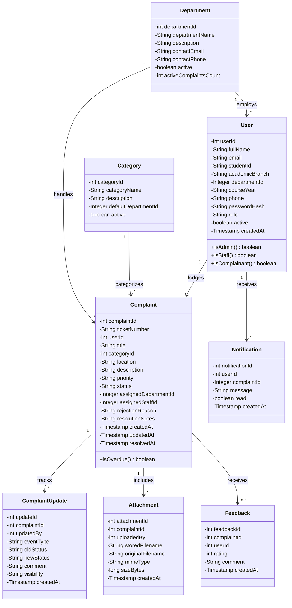
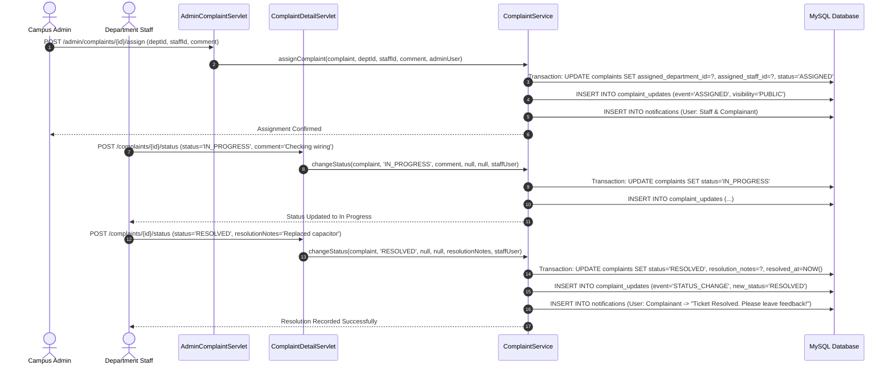
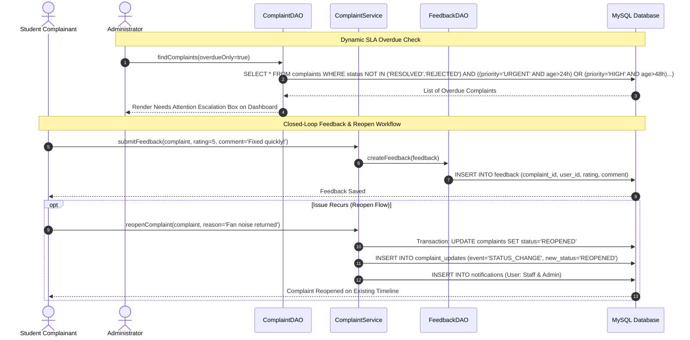

# CampusCare — Centralized College Complaint Management & Grievance Redressal System

> **An enterprise-grade, role-based grievance tracking platform engineered with Java Servlets (javax.servlet), Apache Tomcat 9, JDBC, MySQL 8.0, and Bootstrap 5. Features automated ticket dispatching, multi-tier audit logging, dynamic SLA overdue escalation, and closed-loop student feedback.**

---

## 🌐 Live Deployment & Project Links

| Resource | Platform / Access | Link |
|---|---|---|
| **Live Web Application** | Render Cloud (Docker Web Service) | [https://campuscare-9q79.onrender.com/](https://campuscare-9q79.onrender.com/) |
| **Project SRS & Requirements Specification** | Google Docs | [Access SRS Document](https://docs.google.com/document/d/17RdJIHFeQm6OWTIrF2vsC6-BiDzrfEjy/edit?usp=drive_link&ouid=117987770163555982408&rtpof=true&sd=true) |
| **System Architecture & UML Design Document** | Google Drive (PDF / Slides) | [Access Architecture & UML Design](https://drive.google.com/file/d/1d5yG3qV966yTSdpzQNCiUW4NHDP5pgw2/view?usp=drive_link) |
| **Project Evaluation & Viva Presentation Deck** | Google Drive (Slides) | [Access Presentation Deck](https://drive.google.com/file/d/1x4pU7UPkbIfsyp-wF7OWzeccJ1YXcCLV/view?usp=drive_link) |
| **Comprehensive Project Report & Implementation Guide** | Google Docs | [Access Full Project Report](https://docs.google.com/document/d/1sPgCFAJuHIf1NllXe98M15ccsX4otEFh/edit?usp=drive_link&ouid=117987770163555982408&rtpof=true&sd=true) |

---

## 🔑 Demo Credentials for Viva & Evaluation

The system is pre-seeded with dedicated test accounts across all roles. On the sign-in page (`/login`), click any demo account button to automatically populate credentials:

| Role | Email | Password | Full Name / Institutional Details | Access Capabilities |
|---|---|---|---|---|
| **Student** | `alex@campuscare.edu` | `student123` | Alex Morgan (B.Tech CSE, 3rd Year, `STU-2024-0042`) | Submit complaints, upload photo evidence, track real-time timeline, submit 1–5 star ratings, reopen tickets |
| **Faculty / Teacher** | `faculty@campuscare.edu` | `student123` | Dr. Alan Walker (Associate Professor, CSE Dept) | Lodge academic/departmental infrastructure grievances, track assigned resolutions |
| **Administrator** | `admin@campuscare.edu` | `admin123` | Prof. Robert Vance (Chief Campus Administrator) | Triage complaints, assign departments & staff, manage taxonomy, inspect telemetry, export CSV reports |
| **Department Staff (IT)** | `it.staff@campuscare.edu` | `staff123` | Priya Sharma (IT Support Lead) | Department queue access, internal technician notes, status updates, final resolution notes |
| **Department Staff (Facilities)** | `facilities.staff@campuscare.edu` | `staff123` | Mark Reynolds (Facilities Supervisor) | Physical infrastructure, plumbing, carpentry, and classroom furniture work orders |
| **Department Staff (Electrical)** | `electrical.staff@campuscare.edu` | `staff123` | Vikram Singh (Electrical Maintenance) | Power sockets, lighting, fans, AC repairs, and substation issue resolutions |

> **Institutional Admin Onboarding Key:** `CAMPUS-ADMIN-2026` *(Configured in `application.properties` to verify authorized administrator account creation during registration)*.

---

## 📑 Table of Contents

- [Live Deployment & Project Links](#-live-deployment--project-links)
- [Demo Credentials for Viva & Evaluation](#-demo-credentials-for-viva--evaluation)
- [1. Project Overview](#1-project-overview)
  - [Problem Statement](#problem-statement)
  - [Project Objectives](#project-objectives)
  - [Key Platform Features](#key-platform-features)
  - [Target Personas and User Ecosystem](#target-personas-and-user-ecosystem)
  - [Platform Workflow](#platform-workflow)
- [2. Problem Statement and Objectives](#2-problem-statement-and-objectives)
- [3. Key Features](#3-key-features)
- [4. Technology Stack](#4-technology-stack)
- [5. Three Main Modules and Team Responsibilities](#5-three-main-modules-and-team-responsibilities)
  - [Module 1: Authentication, Role-Based Access Control & User Management](#module-1-authentication-role-based-access-control--user-management)
  - [Module 2: Core Complaint Lifecycle, Ticket Dispatch & Multi-Tier Audit Logging](#module-2-core-complaint-lifecycle-ticket-dispatch--multi-tier-audit-logging)
  - [Module 3: SLA Escalation Engine, Analytics, Notifications & Resolution Feedback](#module-3-sla-escalation-engine-analytics-notifications--resolution-feedback)
- [6. System Architecture Diagram](#6-system-architecture-diagram)
- [7. UML and System Design](#7-uml-and-system-design)
  - [A. Domain Class Diagram](#a-domain-class-diagram)
  - [B. System Use-Case Diagram](#b-system-use-case-diagram)
  - [C. Complaint Lodging & File Attachment Sequence Diagram](#c-complaint-lodging--file-attachment-sequence-diagram)
  - [D. Administrative Triage, Assignment & Resolution Sequence Diagram](#d-administrative-triage-assignment--resolution-sequence-diagram)
  - [E. Dynamic SLA Overdue Escalation & Feedback Sequence Diagram](#e-dynamic-sla-overdue-escalation--feedback-sequence-diagram)
- [8. Screenshots and User Interface Catalog](#8-screenshots-and-user-interface-catalog)
- [9. Feature Implementation Details](#9-feature-implementation-details)
- [10. 12-Week Development Plan](#10-12-week-development-plan)
- [11. Team Contributions & Ownership Matrix](#11-team-contributions--ownership-matrix)
- [12. Project Documentation & Academic Artifacts](#12-project-documentation--academic-artifacts)
- [13. Database Schema (MySQL) & Project Directory Structure](#13-database-schema-mysql--project-directory-structure)
- [14. Installation and Setup](#14-installation-and-setup)
- [15. Servlet Routing & API Endpoint Inventory](#15-servlet-routing--api-endpoint-inventory)
- [16. Testing, Quality Assurance & Acceptance Test Matrix](#16-testing-quality-assurance--acceptance-test-matrix)
- [17. Security Architecture & Threat Modeling](#17-security-architecture--threat-modeling)
- [18. Limitations and Future Improvements](#18-limitations-and-future-improvements)

---

## 1. Project Overview

**CampusCare** is an institutional web portal engineered to streamline the resolution of campus grievances across modern educational institutions. Developed as a high-performance Java EE application utilizing standard `javax.servlet` API, Apache Tomcat 9, and MySQL 8.0, CampusCare replaces antiquated paper forms and unorganized messaging groups with an accountable, transparent, and auditable digital redressal system.

```
┌──────────────────────────────────────────────────────────────────────────────────┐
│                             CAMPUSCARE ECOSYSTEM                                 │
│                                                                                  │
│   [Student / Faculty] ──── Lodges Grievance ────► [Unique Ticket CC-YYYY-XXXXXX]  │
│                                                            │                     │
│                                                            ▼                     │
│   [Public Notification] ◄─── Status Updates ─── [Admin & Dept Triage Engine]     │
│             │                                              │                     │
│             ▼                                              ▼                     │
│   [5-Star Rating / Reopen] ◄── Resolution Notes ◄── [Department Staff Action]    │
│                                                            │                     │
│                                                            ▼                     │
│   [Real-Time SLA Overdue Monitor] ───────────────► [Executive Telemetry / CSV]   │
└──────────────────────────────────────────────────────────────────────────────────┘
```

### Problem Statement
In higher education campuses, facility, electrical, plumbing, network, and hostel grievances are frequently mishandled due to:
1. **Lack of Traceability:** Grievances submitted verbally or on physical registers get lost without a verifiable receipt or tracking number.
2. **Ambiguous Ownership:** Tickets linger because there is no clear assignment to specific maintenance departments or technicians.
3. **Absence of SLA Monitoring:** Urgent safety or infrastructure issues go unnoticed without automated overdue tracking or escalation alerts.
4. **No Closed-Loop Feedback:** Complainants are rarely informed when an issue is resolved, nor are they empowered to rate service quality or reopen unsatisfactorily handled issues.

### Project Objectives
- **Centralized Grievance Logging:** Provide students and faculty with an intuitive interface to lodge categorized grievances with photo/document evidence.
- **Sequential Ticket Tracking:** Assign an immutable, unique ticket identifier (`CC-YYYY-XXXXXX`) to every complaint for non-repudiation.
- **Role-Based Workflow Automation:** Provide distinct operational workspaces for Complainants, Department Technicians, and Central Administrators.
- **Dynamic SLA Overdue Engine:** Continuously compute ticket age against configurable urgency thresholds (Urgent: 24h, High: 48h, Medium: 72h, Low: 120h) to flag delayed tickets.
- **Transparent Audit Trail:** Maintain an append-only timeline documenting every state change, actor, comment, and timestamp.
- **Accountable Redressal:** Require mandatory resolution documentation before closing tickets, paired with a student 5-star rating and reopening mechanism.

### Key Platform Features
- **Strict Role-Based Access Control (RBAC):** Segregated access for `STUDENT`, `FACULTY`, `STAFF`, and `ADMIN` enforced via servlet filter chains.
- **Zero-Friction Embedded & Cloud Execution:** Ships with an embedded Tomcat 9 launcher for 1-click local evaluation, alongside a production Dockerfile deployed on Render.
- **Cryptographic Security:** Salted BCrypt password hashing (12 rounds), Synchronizer Token CSRF defense, and 100% JDBC `PreparedStatement` parameter binding.
- **Formula-Safe CSV Analytics:** Enterprise data export engineered with formula injection neutralization (`=`, `+`, `-`, `@`).

### Target Personas and User Ecosystem

| Persona | Operational Context | Primary Platform Goals |
|---|---|---|
| **Students & Faculty** | Campus residents and academic community | Lodge issues with photo attachments, monitor status milestones in real-time, rate completed repairs, and reopen unsatisfied tickets. |
| **Department Staff** | Electricians, IT support engineers, plumbers, hostel caretakers | View department-specific queues, add internal diagnostic notes, update progress states, and log official resolution summaries. |
| **Campus Administrators** | Deans of Student Affairs, Estate Officers, Chief Administrators | Triage new complaints, dispatch tickets to departments/staff, inspect overdue SLA bottlenecks, and download institution-wide reports. |

### Platform Workflow

```
[Complainant Lodges Issue]
         │ (Generates Ticket CC-YYYY-XXXXXX)
         ▼
    [SUBMITTED] ────────────► [UNDER_REVIEW]
         │                         │
         ├─────────────────────────┘
         ▼
    [ASSIGNED] (Dispatched to Department & Technician)
         │
         ▼
   [IN_PROGRESS] (Technician logs internal diagnostic notes)
         │
         ├─────────────────────────┬─────────────────────────┐
         ▼                         ▼                         ▼
    [RESOLVED]                 [REJECTED]                [OVERDUE]
 (Mandatory Notes)        (Mandatory Reason)      (Breaches SLA Hours)
         │                         │
         ▼                         │
   [Student Feedback:              │
   1–5 Stars or Reopen]            │
         │                         │
         └────────► [REOPENED] ◄───┘
```

---

## 2. Problem Statement and Objectives

In traditional campus administration, grievance management relies heavily on manual ledgers, informal phone calls, or unmonitored email threads. This unstructured process causes significant friction:
- **Zero Accountability:** Maintenance teams cannot track who logged an issue, when it was inspected, or why a delay occurred.
- **Security Vulnerabilities:** Systems often expose student records through unvalidated URL parameters (IDOR) or lack role-based authorization.
- **Inefficient Resource Dispatch:** Administrators lack visibility into department workloads, leading to bottlenecks in critical departments like IT and Electrical Maintenance.

### System Objectives
1. **Mathematical SLA Enforcement:** Automatically identify and highlight complaints that violate Service Level Agreements (SLAs) based on severity:
   $$\text{Overdue Condition} = (\text{Current Time} - \text{Created Time}) > \text{Threshold}(\text{Priority})$$
2. **ACID Transaction Guarantees:** Ensure all ticket updates, timeline logs, and notification dispatches occur within single atomic database transactions to eliminate partial states.
3. **Data Integrity & Protection:** Defend against common web vulnerabilities (SQL Injection, CSRF, XSS, IDOR, CSV Formula Injection) using industry-standard defenses.

---

## 3. Key Features

- **Unique Ticket Numbering:** Automated generation of sequential format `CC-YYYY-XXXXXX` (e.g., `CC-2026-000101`).
- **Dynamic SLA Escalation:** Configurable overdue thresholds calculated natively via SQL:
  - `URGENT`: 24 Hours
  - `HIGH`: 48 Hours
  - `MEDIUM`: 72 Hours
  - `LOW`: 120 Hours
- **Append-Only Timeline Audit Trail:** Immutable logging of actor, old status, new status, public/internal comments, and exact timestamps.
- **Role-Based Workspaces:**
  - **Student Portal:** Personalized dashboard, grievance submission form with file upload, and ticket history.
  - **Staff Portal:** Filtered work queue restricted to technician's assigned department.
  - **Admin Command Center:** Multi-metric KPI cards, category distribution graphs, department management, staff directory, and CSV exporter.
- **Notification Engine:** Real-time in-app notification alerts for status transitions, technician assignments, and public comments.
- **Closed-Loop Feedback:** Mandatory resolution notes from technicians paired with 1–5 star student ratings and comments.
- **One-Click Reopening:** Complainants can reopen resolved tickets within the same thread if the physical issue recurs.
- **Security Defenses:** Built-in BCrypt hashing, CSRF synchronizer tokens, `HttpOnly` cookie session management, and `X-Frame-Options` headers.

---

## 4. Technology Stack

| Technology | Category | Version | Purpose in CampusCare | Associated Module |
|---|---|---|---|---|
| **Java** | Backend Runtime | 21 LTS | Core programming language delivering strict type safety, pattern matching, and enterprise reliability | Module 1 & 2 |
| **Java Servlet API** | Web Framework | 4.0.1 (`javax.servlet`) | Request routing, session management, and stateless/stateful filter chains | Module 1 & 2 |
| **JavaServer Pages (JSP)** | Presentation Layer | 2.3.3 | Dynamic server-side UI rendering with JSTL output escaping | Module 1, 2 & 3 |
| **JSTL Standard** | Tag Library | 1.2 | Safe conditional evaluation (`<c:if>`, `<c:choose>`) and XSS-safe output (`<c:out>`) | Module 2 & 3 |
| **Apache Tomcat** | Web Server / Servlet Container | 9.0.86 | Embedded and standalone HTTP/Servlet container running Java EE 8 specifications | Module 1, 2 & 3 |
| **MySQL Database** | Relational Database | 8.0+ | ACID-compliant relational storage with InnoDB engine and `utf8mb4_unicode_ci` | Module 1, 2 & 3 |
| **MySQL Connector/J** | Database Driver | 8.3.0 | High-performance JDBC driver enabling parameterized SQL execution | Module 1 & 2 |
| **jBCrypt** | Cryptography | 0.4 | Adaptive one-way password hashing using Blowfish cipher with 12 salt rounds | Module 1 |
| **Bootstrap** | CSS Design System | 5.3.3 | Responsive grid, interactive modals, toasts, forms, and custom color variables | Module 1, 2 & 3 |
| **Bootstrap Icons** | Iconography | 1.11.3 | Unified vector iconography across all dashboard screens and navigation links | Module 2 & 3 |
| **Docker** | Containerization | 20+ | Multi-stage build packaging Java runtime and embedded Tomcat for cloud execution | Module 3 |
| **Render** | Cloud Hosting | PaaS | Managed cloud web service hosting live application instance | Module 3 |
| **Maven** | Build Automation | 3.9+ | Dependency resolution, WAR packaging, and embedded server execution plugin | Module 1, 2 & 3 |

---

## 5. Three Main Modules and Team Responsibilities

The CampusCare system architecture is partitioned into three decoupled modules:

```
┌──────────────────────────────────────────────────────────────────────────────────┐
│                            CAMPUSCARE CORE MODULES                               │
├─────────────────────────┬───────────────────────────────┬────────────────────────┤
│        MODULE 1         │           MODULE 2            │        MODULE 3        │
│  Auth, RBAC & Users     │  Complaint Lifecycle Engine   │  SLA, Analytics & Loop │
│                         │                               │                        │
│       Lead:             │             Lead:             │         Lead:          │
│    Rahul Rawat          │        Rishabh Rathore        │      Sachin Kumar      │
│  (Roll: 24EARAD129)     │      (Roll: 24EARAD137)       │   (Roll: 24EARAD144)   │
└─────────────────────────┴───────────────────────────────┴────────────────────────┘
```

---

### Module 1: Authentication, Role-Based Access Control & User Management
**Lead:** **Rahul Rawat** *(Roll No.: 24EARAD129)*  
**Primary Responsibilities & Architectural Scope:**
- **Security Filter Chain Architecture:** Engineered `AuthenticationFilter`, `RoleFilter`, `EncodingFilter`, and `CsrfFilter` (`com.campuscare.filter`) intercepting all incoming HTTP requests.
- **Adaptive Password Cryptography:** Integrated `jBCrypt` with 12 computational rounds for salt generation and one-way password verification (`PasswordUtil.java`).
- **Session & Identity Management:** Engineered session fixation defense by renewing `HttpSession` instances upon authentication, paired with `HttpOnly` cookie flags and browser back-button caching prevention (`Cache-Control: no-cache, no-store`).
- **Multi-Role User Onboarding:** Built registration flows supporting Students (`STUDENT`), Faculty (`FACULTY`), and Key-Gated Administrators (`ADMIN` protected via institutional verification key `CAMPUS-ADMIN-2026`).
- **Administrative Staff Directory:** Developed `AdminStaffServlet` and `UserDAO` allowing campus administrators to create, update, and manage departmental maintenance staff accounts.
- **Database Connection Management:** Implemented thread-safe JDBC connection pooling and environment-variable resolution in `DBConnection.java` and `DatabaseInitializer.java`.

---

### Module 2: Core Complaint Lifecycle, Ticket Dispatch & Multi-Tier Audit Logging
**Lead:** **Rishabh Rathore** *(Roll No.: 24EARAD137)*  
**Primary Responsibilities & Architectural Scope:**
- **State Transition Engine:** Built the core state machine governing valid transitions: `SUBMITTED` → `UNDER_REVIEW` → `ASSIGNED` → `IN_PROGRESS` → `RESOLVED` / `REJECTED` / `REOPENED` with strict permission checks in `ComplaintService.java`.
- **Sequential Ticket Number Generator:** Implemented database-backed, synchronized ticket generation yielding uniform tracking codes (`CC-YYYY-XXXXXX`).
- **Transactional Atomic Operations:** Wrapped complaint creation, status transitions, department dispatches, and notification emissions within single database transactions (`conn.setAutoCommit(false)`, `conn.rollback()`).
- **Append-Only Timeline Audit Trail:** Designed `complaint_updates` schema and `ComplaintUpdateDAO` preserving complete history (actor, old/new states, comments, visibility flags).
- **Public vs. Internal Note Separation:** Built visibility segmentation enabling technicians to post confidential internal diagnosis notes invisible to complainants.
- **Secure File & Evidence Handling:** Implemented `AttachmentServlet` with MIME validation (`image/*`, `application/pdf`), 10MB size limits, and UUID filename obfuscation to prevent path-traversal attacks.
- **IDOR Defense:** Enforced session-based ownership verification in `ComplaintService.getComplaintWithDetails()` preventing cross-tenant ticket inspection.

---

### Module 3: SLA Escalation Engine, Analytics, Notifications & Resolution Feedback
**Lead:** **Sachin Kumar** *(Roll No.: 24EARAD144)*  
**Primary Responsibilities & Architectural Scope:**
- **Priority-Driven SLA Overdue Engine:** Formulated mathematical overdue calculation rules in `ComplaintDAO` dynamically comparing `TIMESTAMPDIFF(HOUR, created_at, NOW())` against priority thresholds (Urgent: 24h, High: 48h, Medium: 72h, Low: 120h).
- **Executive Analytics & KPI Dashboard:** Engineered `DashboardStats.java`, `AdminDashboardServlet`, and `StaffDashboardServlet` computing active ticket counts, department load distributions, and average turnaround time.
- **Real-Time Notification Dispatcher:** Developed asynchronous in-app notification pipeline (`NotificationDAO`, `NotificationServlet`) triggering alerts for ticket milestones, assignments, and technician comments.
- **Closed-Loop 5-Star Feedback System:** Built `FeedbackDAO` and feedback modal requiring 1–5 star ratings and reviews upon resolution, with a 1-click complaint reopening workflow.
- **Formula-Safe CSV Data Exporter:** Authored `ReportService.java` with formula injection sanitization (`ValidationUtil.escapeCsv()`) neutralizing spreadsheet attacks.
- **Cloud Containerization & Deployment:** Created `Dockerfile`, `render.yaml`, and production configuration for live deployment on Render PaaS.

---

## 6. System Architecture Diagram

```
┌──────────────────────────────────────────────────────────────────────────────────┐
│                            CAMPUSCARE ARCHITECTURE                               │
└──────────────────────────────────────────────────────────────────────────────────┘

   [ Web Browser / Mobile Client ]
                 │
                 │ HTTP / HTTPS (Port 8080 / 10000)
                 ▼
┌──────────────────────────────────────────────────────────────────────────────────┐
│                             SECURITY FILTER CHAIN                                │
│                                                                                  │
│  [EncodingFilter] ──► [AuthenticationFilter] ──► [RoleFilter] ──► [CsrfFilter]   │
│   (UTF-8 Enforced)     (Session Verification)     (RBAC Guard)     (Token Check) │
└────────────────────────────────────────────────┬─────────────────────────────────┘
                                                 │
                                                 ▼
┌──────────────────────────────────────────────────────────────────────────────────┐
│                               CONTROLLER LAYER                                   │
│                                                                                  │
│  • LoginServlet / LogoutServlet          • ComplaintServlet                      │
│  • RegisterServlet                       • ComplaintDetailServlet                │
│  • StudentDashboardServlet               • AdminComplaintServlet                 │
│  • StaffDashboardServlet                 • AdminStaffServlet / DepartmentServlet │
│  • AdminDashboardServlet                 • NotificationServlet / ProfileServlet  │
│  • ReportServlet (CSV Export)            • AttachmentServlet                     │
└────────────────────────────────────────────────┬─────────────────────────────────┘
                                                 │
                                                 ▼
┌──────────────────────────────────────────────────────────────────────────────────┐
│                                 SERVICE LAYER                                    │
│                                                                                  │
│  • AuthService (BCrypt, Session Tokens, Role Provisioning)                       │
│  • ComplaintService (State Machine, Atomic Transactions, Assignment, Feedback)   │
│  • ReportService (KPI Aggregation, CSV Formula Sanitization)                     │
└────────────────────────────────────────────────┬─────────────────────────────────┘
                                                 │
                                                 ▼
┌──────────────────────────────────────────────────────────────────────────────────┐
│                            DATA ACCESS OBJECT (DAO) LAYER                        │
│                                                                                  │
│  • UserDAO                • ComplaintDAO             • ComplaintUpdateDAO        │
│  • DepartmentDAO          • CategoryDAO              • AttachmentDAO             │
│  • NotificationDAO        • FeedbackDAO              • DBConnection Manager      │
└────────────────────────────────────────────────┬─────────────────────────────────┘
                                                 │
                                                 │ JDBC PreparedStatements
                                                 ▼
┌──────────────────────────────────────────────────────────────────────────────────┐
│                       PERSISTENCE LAYER (MySQL 8.0 InnoDB)                       │
│                                                                                  │
│   users  •  departments  •  categories  •  complaints  •  complaint_updates      │
│            attachments   •   notifications   •   feedback                        │
└──────────────────────────────────────────────────────────────────────────────────┘
```

---

## 7. UML and System Design

### A. Domain Class Diagram



---

### B. System Use-Case Diagram

```mermaid
flowchart TD
    subgraph Actors
        S[Student / Faculty Complainant]
        A[Campus Administrator]
        T[Department Staff Technician]
        SYS[Automated SLA Escalation System]
    end

    subgraph Authentication & Profile
        UC1[Register Account]
        UC2[Login & Establish Session]
        UC3[Manage Profile Details]
    end

    subgraph Complaint Management
        UC4[Submit Grievance with Photo Attachment]
        UC5[Track Ticket Timeline]
        UC6[Submit 5-Star Feedback]
        UC7[Reopen Resolved Ticket]
    end

    subgraph Administrative Operations
        UC8[Triage Complaint Queue]
        UC9[Assign Department & Technician]
        UC10[Reject Complaint with Reason]
        UC11[Manage Departments & Staff Directory]
        UC12[Export Formula-Safe CSV Reports]
    end

    subgraph Redressal Operations
        UC13[View Department Work Queue]
        UC14[Add Internal Diagnostic Notes]
        UC15[Update Progress State]
        UC16[Resolve Complaint with Notes]
    end

    subgraph Background Services
        UC17[Evaluate SLA Overdue Thresholds]
        UC18[Dispatch Real-Time In-App Alerts]
    end

    S --> UC1
    S --> UC2
    S --> UC3
    S --> UC4
    S --> UC5
    S --> UC6
    S --> UC7

    A --> UC2
    A --> UC8
    A --> UC9
    A --> UC10
    A --> UC11
    A --> UC12

    T --> UC2
    T --> UC13
    T --> UC14
    T --> UC15
    T --> UC16

    SYS --> UC17
    SYS --> UC18
```



---

### C. Complaint Lodging & File Attachment Sequence Diagram

```mermaid
sequenceDiagram
    autonumber
    actor Complainant as Student / Faculty
    participant CS as ComplaintServlet
    participant SVC as ComplaintService
    participant DAO as ComplaintDAO
    participant UDAO as ComplaintUpdateDAO
    participant ADAO as AttachmentDAO
    participant NDAO as NotificationDAO
    participant DB as MySQL Database

    Complainant->>CS: POST /complaints/new (Title, Category, Location, Priority, Description, File)
    CS->>SVC: createComplaint(student, title, catId, location, priority, desc, attachment)
    SVC->>DB: Connection conn = getConnection(); conn.setAutoCommit(false)
    SVC->>DAO: createComplaint(complaint, conn)
    DAO->>DB: INSERT INTO complaints (...)
    SVC->>UDAO: addUpdate(update [CREATED], conn)
    UDAO->>DB: INSERT INTO complaint_updates (...)
    alt Attachment Present
        SVC->>ADAO: createAttachment(attachment, conn)
        ADAO->>DB: INSERT INTO attachments (...)
    end
    SVC->>NDAO: createNotification(studentAlert, conn)
    NDAO->>DB: INSERT INTO notifications (...)
    SVC->>DB: conn.commit()
    SVC-->>CS: Return Complaint Object with Ticket Number
    CS-->>Complainant: Redirect to /complaints?submitted=CC-YYYY-XXXXXX
```

---

### D. Administrative Triage, Assignment & Resolution Sequence Diagram



---

### E. Dynamic SLA Overdue Escalation & Feedback Sequence Diagram



---

## 8. Screenshots and User Interface Catalog

The CampusCare interface adheres to modern, accessible, and responsive visual design standards built with custom Bootstrap 5 styling tokens:

### 1. Landing Page (`/` or `/CampusCare/`)
- **Key Elements:** Official institutional header, headline value proposition, 3-step workflow cards (Submit → Track → Resolve), active department pills (IT Support, Electrical, Plumbing, Hostels), and quick demo account helper cards for evaluation.

### 2. User Authentication & Role Registration (`/login` and `/register`)
- **Key Elements:** Dual sign-in tab interface, one-click demo account filler buttons (`Alex Morgan`, `Prof. Robert Vance`, `Priya Sharma`), student/faculty self-service registration, and key-gated administrator registration enforcing verification code `CAMPUS-ADMIN-2026`.

### 3. Student Grievance Command Center (`/student/dashboard`)
- **Key Elements:** Personalized welcome banner, 4 live metric counter cards (Total Lodged, In Progress, Resolved, Pending Attention), quick-action `+ Submit Complaint` shortcut, and recent ticket table with status badges.

### 4. Complaint Lodging Form (`/complaints/new`)
- **Key Elements:** Structured form with category dropdown, building location input, dynamic urgency priority selector (Low, Medium, High, Urgent with SLA descriptions), rich description textarea, and drag-and-drop file upload zone.

### 5. Ticket Inspection & Timeline View (`/complaints/{ticketNumber}`)
- **Key Elements:** Ticket metadata overview (Ticket ID, Priority Badge, Department, Location, Submitted Date), evidence attachment preview, chronological append-only timeline cards with actor roles, and resolution feedback/reopening dialog.

### 6. Central Administrator Dashboard (`/admin/dashboard`)
- **Key Elements:** Platform-wide telemetry (Total Complaints, Active Pending, Overdue SLA count, Average Resolution Hours, Average Student Rating), category breakdown progress indicators, and the **Needs Attention** overdue escalation table.

### 7. Administrative Complaint Queue (`/admin/complaints`)
- **Key Elements:** Multi-facet filtering toolbar (Filter by Status, Category, Priority, Department, Keyword Search, and Overdue Only toggle), table with pagination, and batch assignment modals.

### 8. Department Staff Work Queue (`/staff/dashboard`)
- **Key Elements:** Focused operational view showing tickets specifically routed to the technician's department, status transition dropdowns, and confidential internal diagnostic notes input.

### 9. System Reports & CSV Export (`/admin/reports`)
- **Key Elements:** Date-range filtering, department performance summary tables, satisfaction index metrics, and one-click **Export to CSV** button protected against formula injection.

---

## 9. Feature Implementation Details

### Module 1: Authentication, RBAC & User Management (Rahul Rawat)
- **BCrypt Password Security:** Implemented in `PasswordUtil.java` using 12 salt rounds:
  ```java
  public static String hashPassword(String plainPassword) {
      return BCrypt.hashpw(plainPassword, BCrypt.gensalt(12));
  }
  ```
- **Stateful Role-Based Guard Filter:** `RoleFilter.java` evaluates session state and path hierarchy:
  ```java
  if (relativePath.startsWith("/admin") && !user.isAdmin()) {
      response.sendError(HttpServletResponse.SC_FORBIDDEN, "Access Denied: Administrator role required.");
      return;
  }
  ```
- **Key-Gated Administrator Provisioning:** `AuthService.registerAdmin()` validates institutional keys against `application.properties` before authorizing administrative privileges.

### Module 2: Complaint Lifecycle & Audit Engine (Rishabh Rathore)
- **Atomic JDBC Transactions:** Multi-table persistence in `ComplaintService.java`:
  ```java
  try (Connection conn = DBConnection.getConnection()) {
      conn.setAutoCommit(false);
      try {
          complaintDAO.createComplaint(c, conn);
          updateDAO.addUpdate(update, conn);
          if (attachment != null) attachmentDAO.createAttachment(attachment, conn);
          notificationDAO.createNotification(notif, conn);
          conn.commit();
      } catch (Exception e) {
          conn.rollback();
          throw e;
      }
  }
  ```
- **IDOR Protection:** In `ComplaintService.getComplaintWithDetails()`:
  ```java
  if (currentUser.isComplainant() && c.getUserId() != currentUser.getUserId()) {
      throw new IllegalAccessException("Access Denied: You cannot view another user's complaint.");
  }
  ```

### Module 3: SLA Engine, Analytics & Feedback Loop (Sachin Kumar)
- **Dynamic SQL-Level SLA Overdue Logic:** Implemented directly in `ComplaintDAO.java`:
  ```sql
  WHERE status NOT IN ('RESOLVED', 'REJECTED')
    AND ((priority = 'URGENT' AND TIMESTAMPDIFF(HOUR, created_at, NOW()) > 24)
      OR (priority = 'HIGH'   AND TIMESTAMPDIFF(HOUR, created_at, NOW()) > 48)
      OR (priority = 'MEDIUM' AND TIMESTAMPDIFF(HOUR, created_at, NOW()) > 72)
      OR (priority = 'LOW'    AND TIMESTAMPDIFF(HOUR, created_at, NOW()) > 120))
  ```
- **CSV Formula Injection Neutralization:** Implemented in `ValidationUtil.java`:
  ```java
  public static String escapeCsv(String value) {
      if (value == null) return "";
      String sanitized = value.trim();
      if (sanitized.startsWith("=") || sanitized.startsWith("+") ||
          sanitized.startsWith("-") || sanitized.startsWith("@")) {
          sanitized = "'" + sanitized;
      }
      return "\"" + sanitized.replace("\"", "\"\"") + "\"";
  }
  ```

---

## 10. 12-Week Development Plan

The table below documents the phased 12-week lifecycle through which CampusCare was conceptualized, engineered, verified, and deployed:

| Week | Main Work Completed | Responsible Module(s) & Team Members | Key Deliverables |
|---|---|---|---|
| **Week 1** | Problem definition, campus stakeholder interviews (students, hostel wardens, facility managers), feasibility study, and SRS formulation. | **All Modules** (Led by Rahul Rawat, Rishabh Rathore, Sachin Kumar) | Software Requirements Specification (SRS), Stakeholder Persona Profiles, Functional Scope Agreement. |
| **Week 2** | System architecture formulation, UML diagrams (Class, Use-Case, Sequence), relational entity modeling, and MySQL 8.0 schema normalization. | **Module 1 & 2** (Rahul Rawat & Rishabh Rathore) | UML Blueprints, Relational Schema (`campuscare_db`), Foreign Key & Indexing Design Specification. |
| **Week 3** | Maven monorepo configuration, Java 21 LTS setup, Servlet 4.0 scaffolding, Bootstrap 5 UI design tokens, and Embedded Tomcat 9 integration. | **Module 1** (Rahul Rawat) & **Module 3** (Sachin Kumar) | `pom.xml`, `ServerLauncher.java`, Base Layout Templates (`header.jsp`, `footer.jsp`, `sidebar.jsp`). |
| **Week 4** | Security architecture implementation: BCrypt password hashing (12 rounds), session fixation protection, and HTTP Security Filter Chains. | **Module 1** (Rahul Rawat) | `AuthenticationFilter`, `RoleFilter`, `EncodingFilter`, `CsrfFilter`, `PasswordUtil.java`. |
| **Week 5** | Multi-role user authentication: Student/Faculty registration, Key-Gated Admin registration (`CAMPUS-ADMIN-2026`), and login/logout controllers. | **Module 1** (Rahul Rawat) | `LoginServlet`, `RegisterServlet`, `LogoutServlet`, `UserDAO`, Quick-Login Viva Helper UI. |
| **Week 6** | Core grievance logging: Category taxonomy, building location mapping, sequential ticket ID generator (`CC-YYYY-XXXXXX`), and form validation. | **Module 2** (Rishabh Rathore) | `ComplaintServlet`, `ComplaintDAO`, Category Mappings, Ticket Generator, `complaint-form.jsp`. |
| **Week 7** | Secure file upload engine: Image/PDF evidence storage, MIME type validation, UUID renaming, and path-traversal prevention. | **Module 2** (Rishabh Rathore) | `AttachmentServlet`, `AttachmentDAO`, Upload Directory Handlers, Multipart Request Parser. |
| **Week 8** | State machine implementation: Atomic status transitions (`SUBMITTED` to `RESOLVED`/`REJECTED`), multi-write transactions, and append-only audit trail. | **Module 2** (Rishabh Rathore) | `ComplaintService.java`, `ComplaintUpdateDAO`, Atomic Commit/Rollback, `complaint-details.jsp`. |
| **Week 9** | Administrative triage & dispatch command center: Department management, staff directory CRUD, queue filters, and technician assignment. | **Module 1** (Rahul Rawat) & **Module 2** (Rishabh Rathore) | `AdminComplaintServlet`, `AdminStaffServlet`, `DepartmentServlet`, `complaint-queue.jsp`. |
| **Week 10** | Priority-based SLA overdue escalation engine (24h/48h/72h/120h thresholds) and real-time in-app notification dispatcher. | **Module 3** (Sachin Kumar) | Dynamic Overdue Query Logic, `NotificationDAO`, `NotificationServlet`, `notifications.jsp`. |
| **Week 11** | Executive telemetry analytics: KPI calculations, category distribution graphs, formula-safe CSV export, and 5-star student rating/reopening loop. | **Module 3** (Sachin Kumar) | `ReportService.java`, `DashboardStats.java`, `FeedbackDAO`, `reports.jsp`, CSV Sanitizer. |
| **Week 12** | Comprehensive test execution (TC-01 to TC-20), Docker containerization, cloud deployment to Render, and academic viva documentation. | **All Modules** (Rahul Rawat, Rishabh Rathore, Sachin Kumar) | Docker Container, Live Render Deployment, Final Documentation, Academic Evaluation Presentation Deck. |

---

## 11. Team Contributions & Ownership Matrix

| Team Member | Roll Number | Assigned Module | Core Contributions & Deliverables |
|---|---|---|---|
| **Rahul Rawat** | `24EARAD129` | **Module 1: Authentication, RBAC & User Management** | Architected the security filter chains (`AuthenticationFilter`, `RoleFilter`, `EncodingFilter`, `CsrfFilter`); implemented salted BCrypt password hashing (12 rounds); developed multi-role registration for Students and Faculty; created key-gated Administrator registration (`CAMPUS-ADMIN-2026`); developed administrative staff directory management (`AdminStaffServlet`); configured JDBC connection pooling (`DBConnection.java`). |
| **Rishabh Rathore** | `24EARAD137` | **Module 2: Core Complaint Lifecycle, Ticket Dispatch & Multi-Tier Audit Logging** | Engineered the transactional state transition engine (`ComplaintService.java`); built unique sequential ticket ID generator (`CC-YYYY-XXXXXX`); implemented atomic database transactions with rollback protection; designed append-only timeline audit trail (`complaint_updates`); built confidential internal technician notes; implemented secure evidence file uploads (`AttachmentServlet`) with MIME and path-traversal safety; enforced IDOR ownership authorization. |
| **Sachin Kumar** | `24EARAD144` | **Module 3: SLA Escalation Engine, Analytics, Notifications & Resolution Feedback** | Formulated mathematical SQL-based SLA overdue escalation rules (24h/48h/72h/120h); developed real-time in-app notification pipeline (`NotificationDAO`, `NotificationServlet`); engineered executive analytics KPI dashboard (`DashboardStats.java`); implemented closed-loop 5-star student feedback system with 1-click ticket reopening; authored formula-safe CSV exporter (`ValidationUtil.escapeCsv()`); containerized app with Docker and deployed to Render PaaS. |

---

## 12. Project Documentation & Academic Artifacts

All supplementary system documentation, architecture diagrams, slides, and evaluation assets are permanently accessible via the following links:

| Document Title | Description | Link |
|---|---|---|
| **Software Requirements Specification (SRS)** | Detailed functional requirements, non-functional constraints, actor personas, and system validation rules. | [View SRS Document](https://docs.google.com/document/d/17RdJIHFeQm6OWTIrF2vsC6-BiDzrfEjy/edit?usp=drive_link&ouid=117987770163555982408&rtpof=true&sd=true) |
| **System Architecture & UML Design Document** | Architectural blueprints, component interaction diagrams, database ER diagrams, and sequence specifications. | [View Architecture & UML Slides](https://drive.google.com/file/d/1d5yG3qV966yTSdpzQNCiUW4NHDP5pgw2/view?usp=drive_link) |
| **Project Evaluation & Viva Presentation Deck** | Slide deck for academic defense, viva presentation, technical stack breakdown, and live demonstration guide. | [View Viva Presentation Deck](https://drive.google.com/file/d/1x4pU7UPkbIfsyp-wF7OWzeccJ1YXcCLV/view?usp=drive_link) |
| **Comprehensive Project Report & Implementation Guide** | In-depth academic report detailing system implementation, database queries, security audits, and user manuals. | [View Full Project Report](https://docs.google.com/document/d/1sPgCFAJuHIf1NllXe98M15ccsX4otEFh/edit?usp=drive_link&ouid=117987770163555982408&rtpof=true&sd=true) |

---

## 13. Database Schema (MySQL) & Project Directory Structure

### Database Schema (MySQL 8.0 InnoDB)

```sql
CREATE DATABASE IF NOT EXISTS campuscare_db
  CHARACTER SET utf8mb4
  COLLATE utf8mb4_unicode_ci;

USE campuscare_db;

-- 1. Campus Maintenance Departments
CREATE TABLE departments (
    department_id INT AUTO_INCREMENT PRIMARY KEY,
    department_name VARCHAR(100) NOT NULL UNIQUE,
    description TEXT,
    contact_email VARCHAR(150),
    contact_phone VARCHAR(50),
    is_active BOOLEAN NOT NULL DEFAULT TRUE,
    created_at TIMESTAMP DEFAULT CURRENT_TIMESTAMP
) ENGINE=InnoDB DEFAULT CHARSET=utf8mb4 COLLATE=utf8mb4_unicode_ci;

-- 2. Issue Categories with Default Department Pre-Routing
CREATE TABLE categories (
    category_id INT AUTO_INCREMENT PRIMARY KEY,
    category_name VARCHAR(100) NOT NULL UNIQUE,
    description VARCHAR(255),
    default_department_id INT NULL,
    is_active BOOLEAN NOT NULL DEFAULT TRUE,
    FOREIGN KEY (default_department_id) REFERENCES departments(department_id)
        ON DELETE SET NULL ON UPDATE CASCADE
) ENGINE=InnoDB DEFAULT CHARSET=utf8mb4 COLLATE=utf8mb4_unicode_ci;

-- 3. Platform Users (Students, Faculty, Staff, Admins)
CREATE TABLE users (
    user_id INT AUTO_INCREMENT PRIMARY KEY,
    full_name VARCHAR(100) NOT NULL,
    email VARCHAR(150) NOT NULL UNIQUE,
    student_id VARCHAR(50) UNIQUE NULL,
    academic_branch VARCHAR(100) NULL,
    department_id INT NULL,
    course_year VARCHAR(60) NULL,
    phone VARCHAR(30) NULL,
    password_hash VARCHAR(255) NOT NULL,
    role ENUM('STUDENT', 'FACULTY', 'ADMIN', 'STAFF') NOT NULL DEFAULT 'STUDENT',
    is_active BOOLEAN NOT NULL DEFAULT TRUE,
    created_at TIMESTAMP DEFAULT CURRENT_TIMESTAMP,
    FOREIGN KEY (department_id) REFERENCES departments(department_id)
        ON DELETE SET NULL ON UPDATE CASCADE
) ENGINE=InnoDB DEFAULT CHARSET=utf8mb4 COLLATE=utf8mb4_unicode_ci;

-- 4. Grievance Complaints
CREATE TABLE complaints (
    complaint_id INT AUTO_INCREMENT PRIMARY KEY,
    ticket_number VARCHAR(30) NOT NULL UNIQUE,
    user_id INT NOT NULL,
    title VARCHAR(200) NOT NULL,
    category_id INT NOT NULL,
    location VARCHAR(150) NOT NULL,
    description TEXT NOT NULL,
    priority ENUM('LOW', 'MEDIUM', 'HIGH', 'URGENT') NOT NULL DEFAULT 'MEDIUM',
    status ENUM('SUBMITTED', 'UNDER_REVIEW', 'ASSIGNED', 'IN_PROGRESS', 'RESOLVED', 'REJECTED', 'REOPENED') NOT NULL DEFAULT 'SUBMITTED',
    assigned_department_id INT NULL,
    assigned_staff_id INT NULL,
    rejection_reason TEXT NULL,
    resolution_notes TEXT NULL,
    created_at TIMESTAMP DEFAULT CURRENT_TIMESTAMP,
    updated_at TIMESTAMP DEFAULT CURRENT_TIMESTAMP ON UPDATE CURRENT_TIMESTAMP,
    resolved_at TIMESTAMP NULL,
    FOREIGN KEY (user_id) REFERENCES users(user_id) ON DELETE RESTRICT ON UPDATE CASCADE,
    FOREIGN KEY (category_id) REFERENCES categories(category_id) ON DELETE RESTRICT ON UPDATE CASCADE,
    FOREIGN KEY (assigned_department_id) REFERENCES departments(department_id) ON DELETE SET NULL ON UPDATE CASCADE,
    FOREIGN KEY (assigned_staff_id) REFERENCES users(user_id) ON DELETE SET NULL ON UPDATE CASCADE,
    INDEX idx_complaints_user (user_id),
    INDEX idx_complaints_status (status),
    INDEX idx_complaints_category (category_id),
    INDEX idx_complaints_dept (assigned_department_id),
    INDEX idx_complaints_created (created_at)
) ENGINE=InnoDB DEFAULT CHARSET=utf8mb4 COLLATE=utf8mb4_unicode_ci;

-- 5. Append-Only Timeline Audit Updates
CREATE TABLE complaint_updates (
    update_id INT AUTO_INCREMENT PRIMARY KEY,
    complaint_id INT NOT NULL,
    updated_by INT NOT NULL,
    event_type VARCHAR(50) NOT NULL,
    old_status VARCHAR(30) NULL,
    new_status VARCHAR(30) NULL,
    comment TEXT NULL,
    visibility ENUM('PUBLIC', 'INTERNAL') NOT NULL DEFAULT 'PUBLIC',
    created_at TIMESTAMP DEFAULT CURRENT_TIMESTAMP,
    FOREIGN KEY (complaint_id) REFERENCES complaints(complaint_id) ON DELETE CASCADE ON UPDATE CASCADE,
    FOREIGN KEY (updated_by) REFERENCES users(user_id) ON DELETE RESTRICT ON UPDATE CASCADE,
    INDEX idx_updates_complaint (complaint_id),
    INDEX idx_updates_created (created_at)
) ENGINE=InnoDB DEFAULT CHARSET=utf8mb4 COLLATE=utf8mb4_unicode_ci;

-- 6. In-App Notifications
CREATE TABLE notifications (
    notification_id INT AUTO_INCREMENT PRIMARY KEY,
    user_id INT NOT NULL,
    complaint_id INT NULL,
    message VARCHAR(300) NOT NULL,
    is_read BOOLEAN NOT NULL DEFAULT FALSE,
    created_at TIMESTAMP DEFAULT CURRENT_TIMESTAMP,
    FOREIGN KEY (user_id) REFERENCES users(user_id) ON DELETE CASCADE ON UPDATE CASCADE,
    FOREIGN KEY (complaint_id) REFERENCES complaints(complaint_id) ON DELETE SET NULL ON UPDATE CASCADE,
    INDEX idx_notif_user_read (user_id, is_read, created_at)
) ENGINE=InnoDB DEFAULT CHARSET=utf8mb4 COLLATE=utf8mb4_unicode_ci;

-- 7. Student Resolution Feedback
CREATE TABLE feedback (
    feedback_id INT AUTO_INCREMENT PRIMARY KEY,
    complaint_id INT NOT NULL UNIQUE,
    user_id INT NOT NULL,
    rating TINYINT NOT NULL CHECK (rating >= 1 AND rating <= 5),
    comment TEXT NULL,
    created_at TIMESTAMP DEFAULT CURRENT_TIMESTAMP,
    FOREIGN KEY (complaint_id) REFERENCES complaints(complaint_id) ON DELETE CASCADE ON UPDATE CASCADE,
    FOREIGN KEY (user_id) REFERENCES users(user_id) ON DELETE RESTRICT ON UPDATE CASCADE
) ENGINE=InnoDB DEFAULT CHARSET=utf8mb4 COLLATE=utf8mb4_unicode_ci;

-- 8. Evidence File Attachments
CREATE TABLE attachments (
    attachment_id INT AUTO_INCREMENT PRIMARY KEY,
    complaint_id INT NOT NULL,
    uploaded_by INT NOT NULL,
    stored_filename VARCHAR(255) NOT NULL,
    original_filename VARCHAR(255) NOT NULL,
    mime_type VARCHAR(100) NOT NULL,
    size_bytes BIGINT NOT NULL,
    created_at TIMESTAMP DEFAULT CURRENT_TIMESTAMP,
    FOREIGN KEY (complaint_id) REFERENCES complaints(complaint_id) ON DELETE CASCADE ON UPDATE CASCADE,
    FOREIGN KEY (uploaded_by) REFERENCES users(user_id) ON DELETE RESTRICT ON UPDATE CASCADE,
    INDEX idx_attach_complaint (complaint_id)
) ENGINE=InnoDB DEFAULT CHARSET=utf8mb4 COLLATE=utf8mb4_unicode_ci;
```

### Project Directory Structure

```
Campus_care/
├── src/
│   └── main/
│       ├── java/com/campuscare/
│       │   ├── controller/               # 15 Java Servlets handling HTTP endpoints
│       │   │   ├── AdminComplaintServlet.java
│       │   │   ├── AdminDashboardServlet.java
│       │   │   ├── AdminStaffServlet.java
│       │   │   ├── AttachmentServlet.java
│       │   │   ├── ComplaintDetailServlet.java
│       │   │   ├── ComplaintServlet.java
│       │   │   ├── DepartmentServlet.java
│       │   │   ├── LoginServlet.java
│       │   │   ├── LogoutServlet.java
│       │   │   ├── NotificationServlet.java
│       │   │   ├── ProfileServlet.java
│       │   │   ├── RegisterServlet.java
│       │   │   ├── ReportServlet.java
│       │   │   ├── StaffDashboardServlet.java
│       │   │   └── StudentDashboardServlet.java
│       │   ├── dao/                      # 8 JDBC Data Access Objects with PreparedStatements
│       │   │   ├── AttachmentDAO.java
│       │   │   ├── CategoryDAO.java
│       │   │   ├── ComplaintDAO.java
│       │   │   ├── ComplaintUpdateDAO.java
│       │   │   ├── DepartmentDAO.java
│       │   │   ├── FeedbackDAO.java
│       │   │   ├── NotificationDAO.java
│       │   │   └── UserDAO.java
│       │   ├── filter/                   # 4 Security and Request Filters
│       │   │   ├── AuthenticationFilter.java
│       │   │   ├── CsrfFilter.java
│       │   │   ├── EncodingFilter.java
│       │   │   └── RoleFilter.java
│       │   ├── model/                    # 9 POJO Domain Entities
│       │   │   ├── Attachment.java
│       │   │   ├── Category.java
│       │   │   ├── Complaint.java
│       │   │   ├── ComplaintUpdate.java
│       │   │   ├── DashboardStats.java
│       │   │   ├── Department.java
│       │   │   ├── Feedback.java
│       │   │   ├── Notification.java
│       │   │   └── User.java
│       │   ├── service/                  # Business Rules, Transitions & Transactions
│       │   │   ├── AuthService.java
│       │   │   ├── ComplaintService.java
│       │   │   └── ReportService.java
│       │   ├── util/                     # Cryptography, Connection, Validation Utilities
│       │   │   ├── ConfigUtil.java
│       │   │   ├── CsrfUtil.java
│       │   │   ├── DatabaseInitializer.java
│       │   │   ├── DBConnection.java
│       │   │   ├── PasswordUtil.java
│       │   │   └── ValidationUtil.java
│       │   └── ServerLauncher.java       # Embedded Tomcat 9 Local Runner
│       ├── resources/
│       │   ├── application.properties    # Database credentials, escalation thresholds & keys
│       │   └── db/
│       │       ├── schema.sql            # Master DDL database schema
│       │       └── seed.sql              # Pre-seeded users, departments, complaints, history
│       └── webapp/
│           ├── WEB-INF/
│           │   ├── views/                # Modular JSP Templates
│           │   │   ├── admin/            # Admin Queue, Dashboard, Departments, Staff, Reports
│           │   │   ├── auth/             # Login and Registration Screens
│           │   │   ├── shared/           # Header, Footer, Sidebar, Notifications, Errors (403, 404, 500)
│           │   │   ├── staff/            # Staff Work Queue Dashboard
│           │   │   └── student/          # Student Dashboard, Complaint Form, My Complaints
│           │   └── web.xml               # Servlet 4.0 Deployment Descriptor
│           ├── assets/
│           │   ├── css/                  # Custom CSS styling tokens
│           │   └── js/                   # Client-side dynamic helpers
│           └── index.jsp                 # Public Landing Page & Demo Helper
├── docs/
│   ├── schema.sql                        # Documentation SQL reference
│   └── seed.sql                          # Documentation seed reference
├── uploads/                              # Local file store for ticket attachments
├── Dockerfile                            # Multi-stage production container build
├── DEPLOYMENT.md                         # Complete Render cloud deployment guide
├── render.yaml                           # Infrastructure as code for Render Web Service
├── run.bat                               # 1-Click Windows execution script
└── pom.xml                               # Maven build configuration
```

---

## 14. Installation and Setup

### Prerequisites
- **Java Development Kit (JDK):** Version 21 LTS or later
- **Apache Maven:** Version 3.9.0 or later
- **MySQL Database Server:** Version 8.0 or later
- **Git:** Version control client

---

### Option A: 1-Click Embedded Execution (Recommended for Local Evaluation)
CampusCare includes an embedded Apache Tomcat 9 launcher. You do not need an external application server installed.

1. **Clone the Repository:**
   ```bash
   git clone https://github.com/rahulrawatt87-tech/CampusCare.git
   cd CampusCare
   ```

2. **Initialize Local Database:**
   Ensure MySQL is running on `localhost:3306`. Create the database:
   ```sql
   CREATE DATABASE IF NOT EXISTS campuscare_db CHARACTER SET utf8mb4 COLLATE utf8mb4_unicode_ci;
   ```
   *(Note: The embedded `DatabaseInitializer` will automatically detect a blank database and execute `schema.sql` and `seed.sql` on first launch!)*

3. **Verify Configuration:**
   Inspect `src/main/resources/application.properties` to ensure your local MySQL password matches:
   ```properties
   db.url=jdbc:mysql://localhost:3306/campuscare_db?useSSL=false&serverTimezone=UTC&allowPublicKeyRetrieval=true
   db.user=root
   db.password=root
   ```

4. **Launch Application:**
   On Windows, double-click **`run.bat`**, or run:
   ```bash
   mvn compile exec:java
   ```

5. **Access Application:**
   Open your browser and navigate to:
   ```
   http://localhost:8080/CampusCare/
   ```
   *(Requests to `http://localhost:8080/` automatically redirect to `/CampusCare/`)*.

---

### Option B: Deploying WAR to External Apache Tomcat 9
1. **Package the Production WAR:**
   ```bash
   mvn clean package -DskipTests
   ```
2. **Deploy to Tomcat:**
   Copy `target/CampusCare.war` into the `webapps/` directory of your Apache Tomcat 9 installation.
3. **Start Tomcat:**
   Execute `bin/startup.bat` (Windows) or `bin/startup.sh` (Linux/macOS).
4. Access at `http://localhost:8080/CampusCare/`.

---

### Option C: Cloud Deployment on Render (Live Production)
CampusCare is deployed on Render as a containerized web service:
1. Connect the GitHub repository `rahulrawatt87-tech/CampusCare` to Render.
2. Select **Docker Runtime** and link to a free cloud MySQL database (e.g., Aiven or TiDB Cloud).
3. Set Environment Variables:
   - `DB_URL`: `jdbc:mysql://<host>:<port>/<dbname>?useSSL=true&allowPublicKeyRetrieval=true`
   - `DB_USER`: `<cloud-username>`
   - `DB_PASSWORD`: `<cloud-password>`
   - `SERVER_CONTEXT_PATH`: `""`
4. Click **Deploy Web Service**. Render builds the Docker image and initializes the live app at:
   [https://campuscare-9q79.onrender.com/](https://campuscare-9q79.onrender.com/)

---

## 15. Servlet Routing & API Endpoint Inventory

| HTTP Method | URL Pattern | Servlet Class | Access Role | Description |
|---|---|---|---|---|
| `GET` | `/` or `/index.jsp` | Default Forward | Public | Landing page featuring 3-step workflow and quick-login viva helpers |
| `GET`, `POST` | `/login` | `LoginServlet` | Public | Authenticates credentials with BCrypt, generates session, redirects by role |
| `GET` | `/logout` | `LogoutServlet` | Authenticated | Terminates active session, clears security context, redirects to login |
| `GET`, `POST` | `/register` | `RegisterServlet` | Public | Student/Faculty registration or key-gated Admin registration |
| `GET` | `/student/dashboard` | `StudentDashboardServlet` | Student / Faculty / Admin | Personal dashboard with KPI counts and recent ticket highlights |
| `GET` | `/complaints` | `ComplaintServlet` | Student / Faculty / Admin | Lists active user's lodged complaints with status filtering |
| `GET`, `POST` | `/complaints/new` | `ComplaintServlet` | Student / Faculty / Admin | Renders grievance form / processes multipart submission with file upload |
| `GET` | `/complaints/*` | `ComplaintDetailServlet` | Complainant / Staff / Admin | Displays ticket timeline, evidence, resolution notes, and feedback dialog |
| `POST` | `/complaints/{id}/status` | `ComplaintDetailServlet` | Staff / Admin | Processes state transitions (`IN_PROGRESS`, `RESOLVED`, `UNDER_REVIEW`) |
| `POST` | `/complaints/{id}/comment` | `ComplaintDetailServlet` | Authenticated Participant | Appends public comment or confidential internal technician note |
| `POST` | `/complaints/{id}/feedback`| `ComplaintDetailServlet` | Complainant Owner | Records 1 to 5 star rating and review on resolved ticket |
| `POST` | `/complaints/{id}/reopen`  | `ComplaintDetailServlet` | Complainant Owner / Admin | Reopens a resolved ticket with preserved audit timeline |
| `GET` | `/staff/dashboard` | `StaffDashboardServlet` | Department Staff / Admin | Department-filtered grievance queue with diagnostic shortcuts |
| `GET` | `/admin/dashboard` | `AdminDashboardServlet` | Admin | Administrative command center with platform metrics and overdue alerts |
| `GET` | `/admin/complaints` | `AdminComplaintServlet` | Admin | Multi-facet complaint queue with category, priority, and overdue filters |
| `POST` | `/admin/complaints/{id}/assign`| `AdminComplaintServlet` | Admin | Dispatches ticket to designated maintenance department and technician |
| `POST` | `/admin/complaints/{id}/reject`| `AdminComplaintServlet` | Admin | Rejects ticket with mandatory rejection reason and student notification |
| `GET`, `POST` | `/admin/staff` | `AdminStaffServlet` | Admin | Lists campus maintenance technicians / Provisions new staff accounts |
| `GET`, `POST` | `/admin/departments` | `DepartmentServlet` | Admin | Manages campus departments (IT, Electrical, Plumbing, Hostels, etc.) |
| `GET` | `/admin/reports` | `ReportServlet` | Admin | Renders resolution turnaround analytics and satisfaction indices |
| `GET` | `/admin/reports/export.csv`| `ReportServlet` | Admin | Streams formula-safe CSV export file of filtered grievance records |
| `GET` | `/attachments/*` | `AttachmentServlet` | Authorized Participant | Streams stored photo or PDF evidence document inline to browser |
| `GET`, `POST` | `/notifications` | `NotificationServlet` | Authenticated | Lists in-app alerts / marks notifications as read |
| `GET`, `POST` | `/profile` | `ProfileServlet` | Authenticated | Manages personal profile details, contact number, and password update |

---

## 16. Testing, Quality Assurance & Acceptance Test Matrix

The system has been evaluated against a comprehensive 20-scenario Acceptance Test Matrix (TC-01 through TC-20) verifying functional correctness, state validity, and security boundaries:

| Test ID | Test Scenario | Input / Action | Expected Result | Result |
|---|---|---|---|---|
| **TC-01** | Student Registration | Valid name, email, roll no, password | Account created in DB with BCrypt hash; auto-login succeeds | **PASS** |
| **TC-02** | Duplicate Email Rejection | Attempt registration with existing email | Registration rejected with user-friendly validation error | **PASS** |
| **TC-03** | Invalid Login Handling | Incorrect password entered at `/login` | Authentication fails; generic message shown; no session set | **PASS** |
| **TC-04** | Role-Based Access Guard | Student requests `/admin/dashboard` | Request intercepted by `RoleFilter`; HTTP `403 Forbidden` returned | **PASS** |
| **TC-05** | Grievance Submission | Submit valid complaint with category & location | Ticket saved; unique ID `CC-YYYY-XXXXXX` generated; notification sent | **PASS** |
| **TC-06** | Server Validation Enforcement | Submit complaint with blank description | Server-side validation catches missing field; blocks submission | **PASS** |
| **TC-07** | IDOR Direct Object Reference | Student A enters Student B's ticket URL | Server checks session ownership; returns HTTP `403 Forbidden` | **PASS** |
| **TC-08** | Admin Department Assignment | Assign department & staff to new ticket | Ticket status moves to `ASSIGNED`; timeline event & notification persist | **PASS** |
| **TC-09** | Mandatory Resolution Notes | Mark ticket `RESOLVED` without notes | Server blocks transition; prompts technician for mandatory resolution note | **PASS** |
| **TC-10** | Timeline Audit Immutability | Move ticket through multiple states | `complaint_updates` records each actor, old/new states, and timestamp | **PASS** |
| **TC-11** | File Upload Safety Check | Upload disallowed file extension (`.exe`) | Multipart filter rejects file safely; displays user validation error | **PASS** |
| **TC-12** | Duplicate Feedback Defense | Submit 5-star rating twice on same ticket | Second attempt blocked by DB UNIQUE constraint on `complaint_id` | **PASS** |
| **TC-13** | Multi-Facet Queue Filtering | Filter admin queue by `IT Support` + `HIGH` | Only matching records returned in table | **PASS** |
| **TC-14** | Session Termination on Logout | Click logout and click browser back button | Session invalidated; back navigation redirects to `/login` | **PASS** |
| **TC-15** | SQL Injection Mitigation | Enter `' OR '1'='1` in search inputs | Sanitized via JDBC `PreparedStatement`; handled as harmless literal | **PASS** |
| **TC-16** | Cross-Site Scripting (XSS) | Enter `<script>alert(1)</script>` in title | Rendered safely as harmless text via JSTL `<c:out>` escaping | **PASS** |
| **TC-17** | Empty Search State | Search for non-existent ticket query | Empty state illustrated with friendly icon and "Clear filters" button | **PASS** |
| **TC-18** | Responsive Viewport Check | Open portal on mobile/tablet viewport | Sidebar collapses to offcanvas; tables adapt horizontally | **PASS** |
| **TC-19** | Database Resilience | Simulate intermittent DB outage | Friendly error page (`error-500.jsp`) displayed without raw stack trace | **PASS** |
| **TC-20** | CSV Formula Injection Defense | Export ticket with title starting with `=cmd` | Cell prefixed with single quote (`'=cmd`) preventing execution in Excel | **PASS** |

---

## 17. Security Architecture & Threat Modeling

```
┌──────────────────────────────────────────────────────────────────────────────────┐
│                            CAMPUSCARE THREAT MODEL                               │
├─────────────────────────┬───────────────────────────────┬────────────────────────┤
│     THREAT VECTOR       │        POTENTIAL IMPACT       │     CAMPUSCARE DEFENSE │
├─────────────────────────┼───────────────────────────────┼────────────────────────┤
│ SQL Injection (SQLi)    │ Unauthorized DB read/write    │ 100% PreparedStatements│
│ Cross-Site Scripting    │ Session cookie hijacking      │ JSTL <c:out> + CSP     │
│ Cross-Site Request      │ Unauthorized ticket actions   │ Synchronizer CSRF token│
│ Insecure Direct Object  │ Viewing other students' files │ Session ownership check│
│ Password Cracking       │ Credential database leak      │ BCrypt (12 salt rounds)│
│ Session Fixation        │ Account takeover              │ Session renewal on auth│
│ CSV Formula Injection   │ Spreadsheet RCE attack        │ Escaping (=, +, -, @)  │
│ Path Traversal Attack   │ Server filesystem compromise  │ UUID file storage keys │
└─────────────────────────┴───────────────────────────────┴────────────────────────┘
```

1. **SQL Injection Defense:** All queries without exception utilize JDBC `PreparedStatement` parameter binding. User inputs are transferred out-of-band as literal parameters, making SQL injection impossible.
2. **Cross-Site Scripting (XSS) Prevention:** All dynamic data in JSP views is escaped through JSTL `<c:out value="${...}"/>` or Expression Language escaping. In addition, HTTP response headers include `X-XSS-Protection: 1; mode=block` and `X-Content-Type-Options: nosniff`.
3. **Cross-Site Request Forgery (CSRF) Tokens:** Every state-changing form submission includes a cryptographically generated synchronizer token stored in the `HttpSession`. `CsrfFilter.java` verifies the token on all incoming `POST` requests.
4. **Session Fixation & Back-Button Defense:** When a user logs in, their existing session is invalidated and renewed. All authenticated responses include strict cache control headers:
   ```
   Cache-Control: no-cache, no-store, must-revalidate
   Pragma: no-cache
   Expires: 0
   ```
5. **IDOR (Insecure Direct Object Reference) Prevention:** Access to individual tickets (`/complaints/*`) requires session identity verification. Complainants attempting to view tickets belonging to other students receive an immediate HTTP `403 Forbidden`.
6. **Formula Injection Sanitization:** CSV exports parse all string values through `ValidationUtil.escapeCsv()`. If a cell starts with `=`, `+`, `-`, or `@`, it is prepended with a single quote (`'`), rendering it as harmless static text in Excel and Google Sheets.

---

## 18. Limitations and Future Improvements

### Current Limitations
- **Single-Node In-App Notifications:** Notifications are stored in MySQL and polled on page load rather than pushed via persistent bidirectional WebSockets.
- **Local / Ephemeral File Storage:** While containerized on Render, file uploads are saved to disk; scaling horizontally across multiple web nodes will require cloud object storage.
- **Manual Department Triage:** While category-to-department defaults exist, ticket reassignment is currently performed manually by administrators.

### Future Improvements
1. **Push Notifications & SMS/Email Gateways:** Integrate Twilio or SendGrid APIs to dispatch instant SMS and email alerts directly to student and technician phones.
2. **AI-Powered Natural Language Triage:** Incorporate automated sentiment analysis and issue categorization to prioritize urgent water/electrical hazards automatically.
3. **Cloud Object Storage (Amazon S3 / Cloudflare R2):** Shift image evidence storage from local disk to S3 buckets using pre-signed upload URLs.
4. **Native Mobile Application:** Develop Flutter or React Native mobile apps for technicians in the field with offline photo capture and barcode scanning for campus assets.
5. **WebSocket Push Pipeline:** Implement Java WebSocket endpoints (`javax.websocket`) for instantaneous live chat between students and technicians on the ticket timeline.

---

<div align="center">

**CampusCare v2.0 — Centralized College Complaint Management & Redressal System**  
*Developed for Higher Education Institutions • Live on Render Cloud*

**Team Members:**  
**Rahul Rawat** (`24EARAD129`) • **Rishabh Rathore** (`24EARAD137`) • **Sachin Kumar** (`24EARAD144`)

</div>
